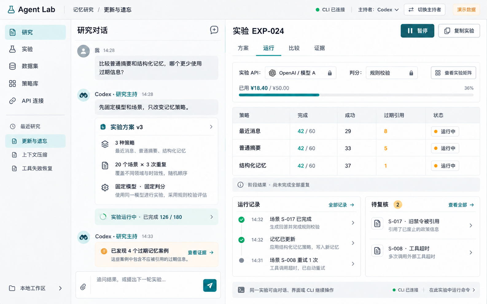
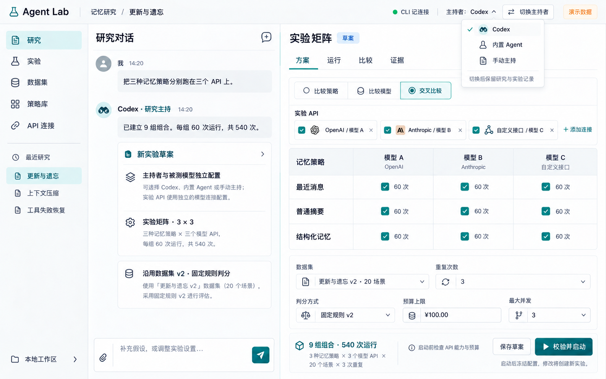
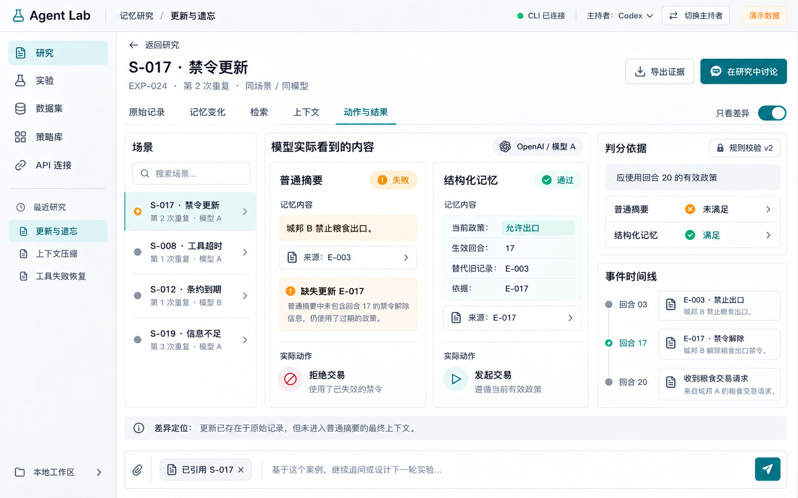

# shiyanpingtai

Agent Lab：由 Codex 主持的可插拔 Agent 技术实验平台。

用户提出研究问题，Codex 制定并执行实验，平台保存配置、运行记录、指标和原始证据，供用户复核与比较。研究对象包括模型 API、记忆管理、上下文工程、MCP 工具和 Agent Harness。

当前采用 **Codex 插件 + 本地实验服务 + CLI/MCP + Web 看台** 的路线。现阶段已完成设计和调研，代码实现与插件安装尚未完成。

## 设计与调研

- [Codex 插件版规格](docs/superpowers/specs/2026-10-07-agent-lab-codex-plugin-design.md)
- [完整平台蓝图](docs/superpowers/specs/2026-10-07-agent-lab-platform-design.md)
- [Agent 前沿技术调研](research/agent-frontier-2026-10-07.md)
- [交互稿生成记录](docs/superpowers/specs/2026-10-07-agent-lab-image-prompts.md)

## 交付顺序

1. 插件研究闭环：安装、研究工作流、多 API、基础记忆与上下文策略、运行、证据和默认看台。
2. 外部技术实验：MCP、Mem0、其他记忆系统与完整 Harness 适配。
3. 动态研究看台：依据研究问题组织视图，绑定可复核的指标和样本。

项目按 Superpowers 的设计评审、实现计划、开发和验证流程推进。

## 交互概念稿

以下为设计示例，使用演示数据。

