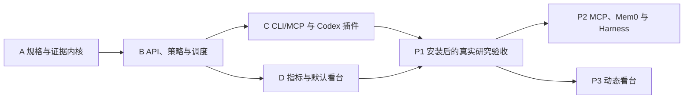

# Agent Lab 插件首版交付路线图

日期：2026-10-07。本文是完整 P1 的协调与验收路线图；逐步编写代码的执行计划按可独立交付的子项目维护。产品范围：[插件规格](../specs/2026-10-07-agent-lab-codex-plugin-design.md)，公共语义：[契约](../specs/2026-10-07-agent-lab-contracts.md)。

## 1. 依赖与退出条件

| 交付 | 独立使用结果 | 必须通过的完成条件 |
| --- | --- | --- |
| A | 命令行保存、检查与导出不可变规格和证据 | 无网络的包安装验收、跨进程读取、冲突与篡改测试 |
| B | CLI 提交白盒实验并获取实际请求和结果 | 单机恢复、隔离、预算及真实 API 小规模配对实验 |
| C | 在 Codex 新会话中发现并调用已安装插件 | marketplace 缓存副本可用、stdio 协议、入口语义一致 |
| D | 浏览器跟踪、比较、检查并导出实验 | 真实数据刷新、指标口径核对、案例证据与重开 |
| P1 总验收 | 在现有 Codex 提问后完成可复核研究 | B/C/D 全部验收，不用离线测试数值替代真实效果 |

## 2. A：规格与证据内核

执行[详细计划](./2026-10-07-agent-lab-core.md)。产出 `src/agentlab/{specs,workspace,artifacts,store,bundles,cli}.py`、规格样例、`tests/core/`。不访问供应商，不引入后台模型调用。A 的库接口和 JSON 契约是 B/C/D 的依赖。

## 3. B：多 API、策略与单机运行

范围覆盖连接管理、实际模型请求、三种策略、场景开放视图、程序判分、持久运行队列、worker 隔离、预算和恢复。

| 工作包 | 主要文件 | 具体行为与验证 |
| --- | --- | --- |
| B1 连接与适配器 | src/agentlab/models/contracts.py、openai.py、anthropic.py、compatible.py、tests/models/ | 明确模型、连接版本、能力、原响应和用量；测试不丢参数及未知用量；按官方文档分别确认原生协议 |
| B2 场景与判分 | src/agentlab/scenarios/public_view.py、grading/temporal.py、datasets/temporal-facts/、tests/scenarios/ | 提供事实更新、长间隔、干扰、信息不足四类场景；模型输入不含 private evaluator；固定答案规则有正反夹具 |
| B3 三种策略 | src/agentlab/strategies/window.py、summary.py、structured.py、tests/strategies/ | 保存选入/排除内容、摘要来源、事实替代与检索；摘要和提取额外用量可追踪；不同 Attempt 不串状态 |
| B4 调度与预算 | src/agentlab/runs/{submission,leases,budget,scheduler,worker}.py、tests/runs/ | 原子提交矩阵，当前 Attempt 的租约代际校验，暂停不影响在途，取消与完成竞争不覆盖证据 |
| B5 服务与真实验收 | src/agentlab/server/{app,lifecycle,operations}.py、tests/integration/ | 本机服务拥有 DB，健康检查包含工作区身份；kill/restart 可见 interrupted；真实模型小样本与测试后端分开标识 |

B 的实施准备任务是写出该子项目的具体 spec/plan，以公共契约为输入，按实际供应商 SDK/API 文档固定协议和依赖。API 凭据与预算选择由真实调用前的工作流处理；既有授权不重复确认。B 的真实结果至少覆盖一条实际 API 与两种策略；其他连接显示实际验证范围。

## 4. C：Codex 插件与工具入口

| 工作包 | 主要文件 | 具体行为与验证 |
| --- | --- | --- |
| C1 HTTP 客户端与命令 | src/agentlab/client.py、cli.py、commands/、tests/client/ | 保留原 CLI 入口并把运行子命令放入 commands；遵循操作契约、分页与错误码；工作区不匹配失败；启动后立即返回 ID；网络重放不新增提交 |
| C2 stdio MCP 桥接 | src/agentlab/mcp/{server,tools}.py、tests/mcp/ | 使用固定的官方 MCP SDK 版本；stdout 仅协议；不同工具委托同一操作；退出桥接不停止实验 |
| C3 插件包装 | plugins/agent-lab/plugin.json、mcp.json、skills/research/SKILL.md、.agents/plugins/marketplace.json | `agentlab mcp` 通过已安装运行时启动；缓存路径与工作区分离；便携与兼容清单语义一致 |
| C4 研究 Skill | plugins/agent-lab/skills/research/references/、tests/acceptance/ | 问题→假设→规格→校验→提交→比较→引用；错误、无凭据、未知成本和未完成结果均准确解释 |
| C5 安装验收 | scripts/verify_plugin_install.py、docs/plugin-install.md | 在当前 Codex 新会话用已安装副本发现工具；调用冻结/查询，不把本地文件存在当作宿主集成成功 |

C 的实施 spec/plan 必须包含准确清单、工具 JSON schema、进程启动方式与 Codex 兼容检查。本机插件安装属于已选择路线；公共目录发布另行处理。研究功能不依赖 Hooks；宿主观测可以单独扩展。

## 5. D：指标与默认看台

| 工作包 | 主要文件 | 具体行为与验证 |
| --- | --- | --- |
| D1 指标和配对查询 | src/agentlab/analysis/{metrics,compare}.py、tests/analysis/ | 按公共契约计算分母、缺失、失败和部分已知费用；场景级配对与 bootstrap 有固定夹具 |
| D2 看台 API | src/agentlab/server/dashboard.py、tests/dashboard_api/ | 返回规格、矩阵、状态、查询与证据；游标重连，局部筛选不覆盖冻结标准 |
| D3 页面 | web/src/{api,views,components}/、web/tests/ | 研究/实验列表、矩阵、进度、比较、证据；常驻版本与缺失信息；复制稳定案例引用 |
| D4 运行与导出 | web/src/events.ts、src/agentlab/server/static.py、tests/acceptance/ | 页面重开后恢复状态；服务退出的连接状态明确；自有静态页面同源发布；导出包含规则与原证据 |
| D5 视觉与使用验收 | docs/dashboard-review.md、tests/acceptance/ | 使用实际运行数据检查筛选、案例对照、刷新与宽屏布局；截图不包含凭据，演示内容有标识 |

D 先使用固定组件和可复核查询。动态组件编排、自定义前端执行和第三方 MCP Apps 属于 P3。D 的实施 spec/plan 根据已有交互稿规定字段、空状态和交互，不能直接把生成图片当成组件规格。

## 6. P1 总验收脚本的行为

- [ ] 在新的工作区启动已安装包和本地服务，连接预先授权的小规模实验 API。
- [ ] 安装插件并开始 Codex 新会话，提出过期事实研究问题。
- [ ] 从同一研究问题生成两变体、至少四场景、两次重复的规格；检查展开计数与固定判分版本。
- [ ] 通过 MCP 提交，用同一幂等键通过 CLI 重放，得到同一 Submission。
- [ ] 打开看台观察进度；关闭 MCP 后任务继续。
- [ ] 对一个运行制造可控中断并重开服务，检查 interrupted 和新 Attempt，旧证据仍可读取。
- [ ] 比较结果，检查一条错误案例的记忆来源、实际请求、响应与判分；少量场景不报告显著性。
- [ ] 重新判分生成新 ScoreSet，原始判分可重开。
- [ ] 导出证据并验真，分别展示已知费用和未知费用覆盖数量。

这里描述待执行的验收流程，不表示任何模型实验已经运行。实施阶段为以上行为编写 `tests/acceptance/test_plugin_research.py` 和人工检查记录。

## 7. 范围覆盖与后续

| 产品规格要求 | 对应工作包 |
| --- | --- |
| 安装、工作流与工具发现 | C2–C5 |
| CLI/MCP 同语义、幂等 | A + B4 + C1/C2 |
| 多 API、参数与能力 | B1/B5 |
| 三种策略、场景与隔离 | B2/B3/B4 |
| 日志、不可变证据、导出 | A + B3/B5 + D4 |
| 暂停、取消、重试、恢复、预算 | B4/B5 |
| 独立判分、重判分与指标 | B2 + D1 |
| 看台、实际上下文与案例引用 | D2–D5 |
| 扩展分类与限制展示 | B1/B3 的注册表 + C3 + D3 |

P2 以 MCP 工具调用的语义评测和 Mem0 的状态隔离为首批外部接入；P3 以持久 ViewSpec 和注册组件为动态展示基础。完整产品目标保持不变，P1 阶段不把这些未完成适配器列为可运行方案。

执行方式默认建议当前会话分批推进，阶段边界核对证据。若用户选择多 Agent 模式，再按 Superpowers 的独立任务分配和两阶段审查执行。这个路线图不授权新的付费范围或外部副作用。
